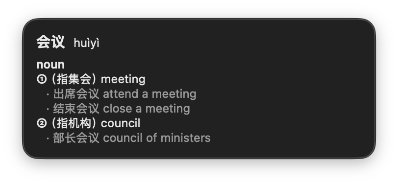
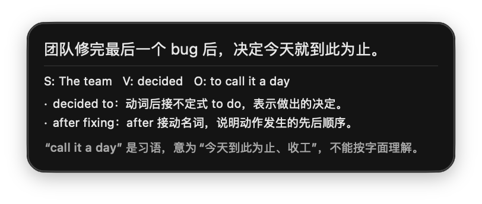
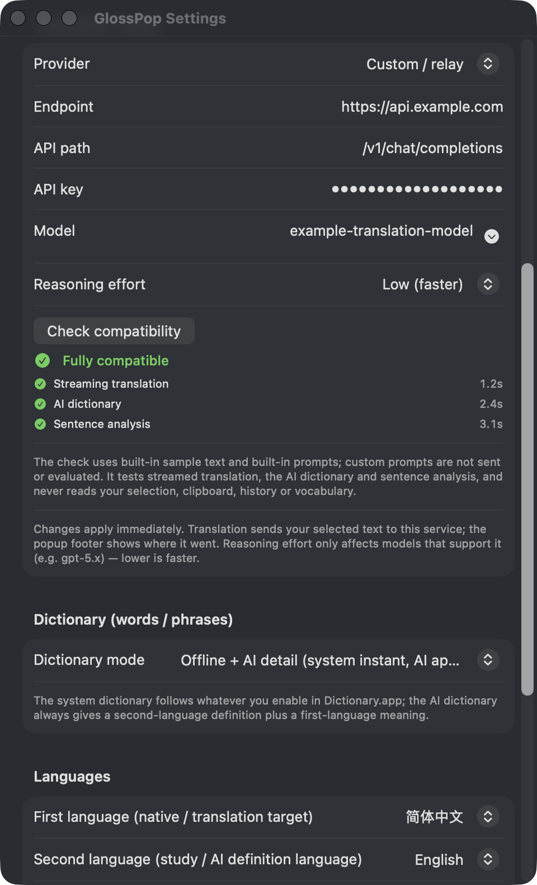

# GlossPop

[English](README.md) | **简体中文**

**macOS 划词翻译。** 在任何 App 里选中文字,按一个快捷键,得到一份**既是翻译、又是词典、还是语法老师**的 LLM 结果——流式呈现在光标旁的浮窗里,**默认不碰你的剪贴板**,**绝不抢焦点**。

   [](https://github.com/Goldenmonstew/GlossPop/releases/latest) 

<p align="center">
  <a href="https://github.com/Goldenmonstew/GlossPop/releases/latest"><b>⬇️&nbsp;&nbsp;下载 GlossPop</b></a> — 免费,苹果公证,自动更新
</p>

<p align="center">
  
</p>

界面跟随系统语言——简体中文、繁體中文、English、日本語、한국어、Français、Deutsch、Español、Русский。

## 它有什么不一样

多数划词翻译要么脆弱(常驻事件监听拖慢系统、污染剪贴板),要么只会糊一段干巴巴的译文。GlossPop **能看懂你选的是什么**,而且足够可靠:

- 🧠 **按内容自适应。** 选单词/短语 → 完整**词典**词条(发音、词性义项、例句、近义词、习语);选句子 → **翻译 + 解析**(主谓宾、语法点,以及习语或难词的注释——全部用**你的母语**解释,而非原文语言);整段则保留译文和注释、略去逐句主谓宾;普通短语 → 干净的流式翻译。
- 🔑 **用你自己的模型。** 翻译跑在你选择的 LLM 上——**自带密钥**接任何 OpenAI 兼容端点(云端、中转、本地 **Ollama** / **LM Studio**),支持的设备上也可用端上 **Apple Foundation Models**。
- 🔒 **零副作用。** 辅助功能优先取词——无常驻 `CGEventTap`,默认不碰剪贴板,焦点永远留在你的 App。浮窗角标如实标注你的文字去了哪里。

<p align="center">
  
</p>

## 安装

1. 从 [**Releases**](https://github.com/Goldenmonstew/GlossPop/releases/latest) 页面下载最新的 **`GlossPop-x.y.z.dmg`**(苹果公证)。
2. 打开 DMG,把 **GlossPop** 拖进 **Applications**。
3. 启动——菜单栏出现 💬 图标。首次划词翻译时按提示授予**辅助功能**权限(系统设置 ▸ 隐私与安全性 ▸ 辅助功能 ▸ 勾选 GlossPop),这是它不碰剪贴板就能读取选区的方式。

更新经 [Sparkle](https://sparkle-project.org) 自动推送(也可菜单 ▸ 检查更新…)。

## 使用

- 在任意 App 选中文字 → 按 **⌃⌘T** → 浮窗在光标旁弹出。
- 按 **Esc** 或点击别处关闭;源 App 的选区保持原样。
- 从菜单栏图标打开**设置…**,选择语言、词典模式和翻译引擎。

## 生词本（v1.1）

- 使用结果卡片上的操作按钮**复制结果**，或把单词、短语收藏到生词本。
- 从菜单栏打开**生词本**，可搜索已收藏内容、按语言组合筛选，也可删除单条记录或清空全部内容。
- 可将生词本中的全部内容导出为 CSV 或兼容 Anki 的 UTF-8 文本。CSV 用于外部使用，不是无损备份，GlossPop 目前也不支持将其重新导入。

## 自带模型(BYOK)

<p align="center">
  
</p>

设置 ▸ *翻译模型*:

1. **服务商 / 端点** — 任何 OpenAI 兼容端点(OpenAI、DeepSeek、你的中转,或本地 Ollama 的 `http://localhost:11434`)。
2. **API 密钥** — 只存在 macOS **钥匙串**里,别处不留。
3. **模型** — 手动输入,或从 `/v1/models` 拉取列表;**检查兼容性**会用 GlossPop 的内置样例文本与内置提示词,走真实的流式翻译、AI 词典和句子解析链路,检查输出语言并显示各阶段耗时。自定义提示词既不会发送,也不会参与评估。
4. 改动即时生效——对新云端服务的首次检查只发送明确披露的内置样例文本与内置提示词,同时也是今后发送选中文本的一次性确认。

端点是云端/中转时,浮窗底部会标注**「云」**,让你始终知道文字离开了本机;回环地址(`localhost`)标注**「本机」**。界面已本地化为简体中文、繁體中文、English、日本語、한국어、Français、Deutsch、Español、Русский,跟随系统语言。

## 隐私

- **默认零剪贴板**,词/短语路径可完全离线(macOS 系统词典)。在你配置并通过**检查兼容性**确认之前,任何内容都不会发往云端;检查本身不会读取选区、剪贴板、历史记录或生词本,只发送明确披露的内置样例文本与内置提示词,自定义提示词不会发送或参与评估。
- 可选的「合成复制」兜底(针对 Safari/Electron 等不暴露选区的 App)**默认关闭**;开启时也会立即恢复你原来的剪贴板。
- 默认情况下，选中内容不会被存储或记录。若开启**翻译历史**，选中内容及已有结果会以明文保存在本机；明确收藏单词或短语时，该词语及其词典结果也会写入本机生词本。
- 生词本中的有效记录以明文形式仅存于本机，可逐条删除、全部清空或随时导出。若 GlossPop 在恢复时保留了损坏的词库文件，会显示备份位置，供你在访达中检查或删除。

## 从源码构建

需要 Xcode 26+ 和 [XcodeGen](https://github.com/yonaskolb/XcodeGen)(`brew install xcodegen`)。

```bash
make build   # xcodegen generate + xcodebuild
make run     # 构建并启动
make test    # 单元测试
```

维护者发布流水线(Developer ID 签名 → 公证 → DMG → Sparkle appcast)见 [`scripts/release.sh`](scripts/release.sh)。

## 参与贡献

欢迎 Issue 和 PR——见 [CONTRIBUTING.md](CONTRIBUTING.md)。macOS 15+,通用二进制(Apple Silicon + Intel),Swift 6(严格并发)。

## 许可证

[AGPL-3.0-or-later](LICENSE)。© 2026 wanruncong。
